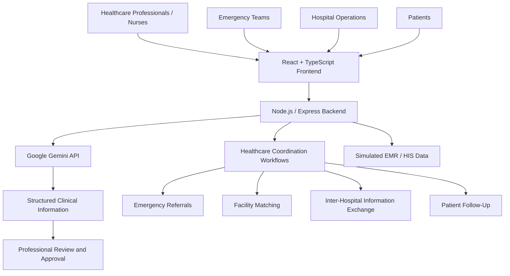
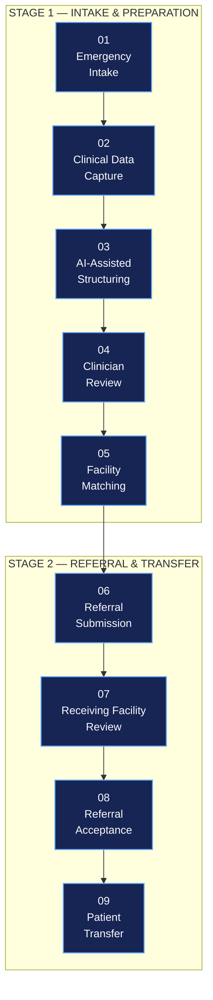

# CareBridge 🏥
### AI-Assisted Healthcare Coordination & Clinical Intelligence Platform

**CareBridge** is an AI-assisted healthcare coordination platform designed to connect patients, healthcare professionals, emergency teams, and hospitals through structured clinical documentation, intelligent referral coordination, and secure information exchange.

The platform aims to improve continuity of care by ensuring that relevant patient information moves securely across healthcare facilities and throughout the patient journey.

🔗 **Live Demo:** https://carebridge--zeta.vercel.app/

---

## 🚀 Key Features

- **AI-Assisted Clinical Documentation:** Converts voice-based clinical input into structured documentation using Google Gemini API, with healthcare professional review before submission.
- **Clinical Trend Detection:** Highlights potentially significant changes in patient observations to support clinical awareness and timely review.
- **Emergency Referral Management:** Provides a structured workflow for submitting, reviewing, accepting, and coordinating patient referrals.
- **Intelligent Facility Matching:** Supports receiving-facility selection based on available beds, required specialists, and operational capacity.
- **Inter-Hospital Information Exchange:** Enables authorised facilities to request and exchange relevant patient information rather than unnecessarily duplicating entire medical records.
- **Patient Follow-Up:** Supports post-discharge medication reminders, follow-up notifications, rehabilitation plans, and patient check-ins.
- **Healthcare Operations Insights:** Aims to provide aggregated insights into bed utilisation, referral patterns, patient flow, and resource demand.

---

## 🛠️ Technology Stack

| Technology | Purpose |
|---|---|
| React | Frontend user interface |
| TypeScript | Type safety and maintainability |
| Vite | Development server and build tooling |
| Tailwind CSS | Responsive UI styling |
| Node.js | Backend runtime |
| Express.js | Backend API and request handling |
| Google Gemini API | AI-assisted voice-to-documentation and structured extraction |
| GitHub | Version control and source management |
| Vercel | Application deployment |

---

## 🏗️ System Architecture & Integration Flow

CareBridge follows a layered architecture connecting user interfaces, backend services, AI processing, and healthcare information systems.



### How the System Works

1. **User Interaction:** Healthcare professionals, emergency teams, hospital operations teams, and patients interact through role-oriented frontend interfaces.
2. **Backend Processing:** Requests are handled by the Node.js/Express application layer, which coordinates the relevant workflows.
3. **AI Integration:** Clinical voice input is processed through the Google Gemini API for structured information extraction.
4. **Human Validation:** AI-generated documentation is presented to healthcare professionals for review and approval.
5. **Healthcare Coordination:** The platform supports referral management, facility matching, patient information exchange, and follow-up workflows.
6. **Information Visibility:** Relevant clinical and operational information is presented to authorised users to support continuity of care.

**Architecture principle:** CareBridge is designed as a coordination layer that works alongside existing EMR/HIS infrastructure rather than replacing hospital information systems.

---

## 🔄 Core Referral Workflow

CareBridge structures emergency referrals into a traceable, two-stage workflow:



This workflow reduces reliance on fragmented calls, messages, and paper-based information exchange while helping receiving facilities prepare before patient arrival.

---

## 💻 Getting Started

Follow these instructions to set up the project locally.

### Prerequisites

- Node.js (LTS recommended)
- npm
- Git
- Google Gemini API key

### 1. Clone the Repository

```bash
git clone <YOUR_GITHUB_REPOSITORY_URL>
```

### 2. Navigate to the Project

```bash
cd carebridge
```

### 3. Install Dependencies

```bash
npm install
```

If the frontend and backend have separate `package.json` files, install dependencies in their respective directories.

### 4. Configure Environment Variables

Create a `.env` file and configure the required environment variables.

Example:

```env
GEMINI_API_KEY=your_gemini_api_key
PORT=5000
```

Add any additional environment variables required by the application.

**Important:** Keep API keys and other sensitive credentials on the server side. Never commit your `.env` file to GitHub.

### 5. Run the Application

Start the frontend development server:

```bash
npm run dev
```

Start the backend using the server script defined in its `package.json`, if it runs separately.

For example:

```bash
npm run server
```

### 6. Build for Production

```bash
npm run build
```

To preview the production build:

```bash
npm run preview
```

---

## 🧪 Prototype Information

CareBridge currently demonstrates its healthcare coordination workflows using simulated EMR/HIS data.

The prototype focuses on demonstrating:

- AI-assisted clinical documentation.
- Clinical observation and trend visibility.
- Emergency intake and referral coordination.
- Facility matching and referral status management.
- Authorised information-sharing workflows.
- Healthcare continuity and post-discharge follow-up.

Live hospital integrations, real-world inter-hospital data exchange, and clinical deployment require additional infrastructure, validation, and institutional authorisation.

AI-generated clinical information is intended for professional review. CareBridge does not autonomously diagnose patients, prescribe medication, or override clinical decisions.

---

## 🎯 Project Vision

Our vision is to build a connected healthcare ecosystem where patients, healthcare professionals, hospitals, and emergency services can coordinate care through secure and structured information exchange.

**The patient should not have to carry the information. The information should move securely ahead of the patient.**

---


**CareBridge — Information that moves with the patient.**
